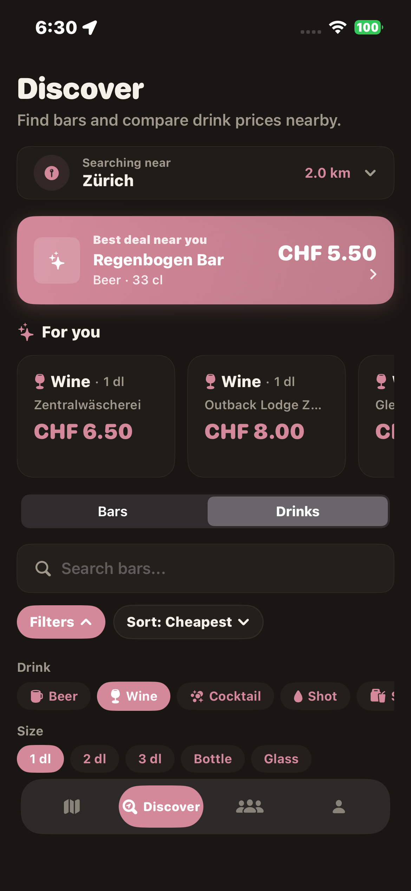
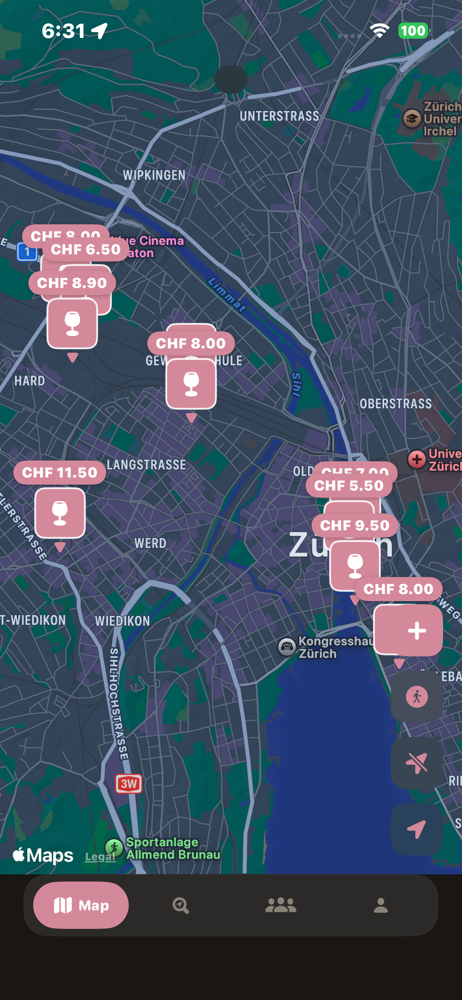
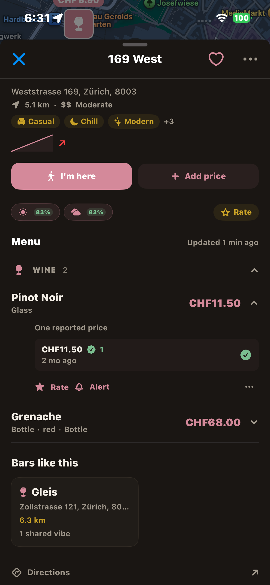
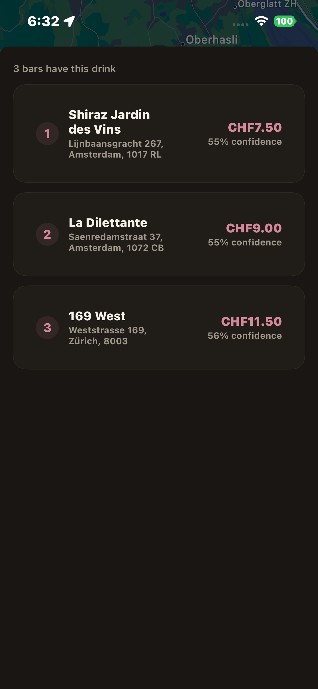
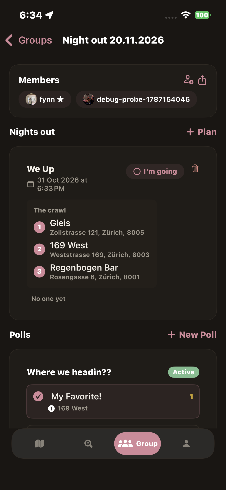

<div align="center">


# BarTab

**Know what you're paying before you go.**

Crowdsourced drink prices at bars, reported by people who were standing at the bar.

[](https://bartap.info)


[**Website**](https://bartap.info) · [Privacy](https://bartap.info/privacy.html) · [Terms](https://bartap.info/terms.html) · [Support](mailto:support@bartap.info)

</div>

---

<p align="center">
  
  
  
  
  
</p>

## About

A pint in Zürich's Niederdorf can cost twice what it does two tram stops away, and you usually only find out when the bill arrives. BarTab is an iOS app where people report what they actually paid, so you can check before you order.

Every price on the map was reported by someone who paid it. Nothing is scraped and nothing comes from old menu photos. The app is free, has no ads, and bars can't pay to rank higher.

**Coming soon to the App Store.** Leave your email at [bartap.info](https://bartap.info) and you'll get a note when it's available in your city.

## Features

- Nearby bars on a map or in a list, filterable by distance, vibe and outdoor seating
- Price comparison for beer, wine and cocktails, with price history
- Reporting a price takes about ten seconds
- Price alerts when a nearby bar hits the price you set
- Following friends to see where they've been
- Group polls and bar hop planning for nights out
- Badges, a passport of visited bars and a leaderboard
- A home screen widget
- English, German, French and Italian

### How prices stay current

Older reports get a "still accurate?" prompt that anyone can confirm or correct, and prices nobody confirms for a while drop down in search. Prices are self-reported and not checked with the venues, so treat them as a good guess rather than a promise.

## Tech

- **App:** Swift, SwiftUI, MapKit, WidgetKit
- **Backend:** [Supabase](https://supabase.com) for auth, database and Edge Functions
- **Edge Functions:** TypeScript on Deno (`waitlist`, `price-alert`, `create-payment-intent`)
- **Payments:** Stripe, for the optional tip jar
- **Website:** plain HTML and CSS in `web/`, hosted on Vercel
- **CI:** GitHub Actions builds the app on every push to `main` and `dev`

```
BarTab/              the iOS app
BarTabWidget/        home screen widget
BarTabTests/         unit tests
BarTabUITests/       UI tests
supabase/functions/  Edge Functions
web/                 the site at bartap.info
```

## Running it yourself

You need a Mac with Xcode. The app targets iOS 16.2 and up.

```bash
git clone https://github.com/Swissschoggi/BarTab.git
cd BarTab
open BarTab.xcodeproj
```

Pick the BarTab scheme and run it on a simulator.

The app talks to a Supabase backend. To use your own, set `projectURL` and `anonKey` in `BarTab/Models/SupbabaseClient.swift`. The tip jar also needs a Stripe publishable key in the same file, which you can leave empty if you don't need it. Keep secret keys (Supabase service role, Stripe secret) out of the repo and in your Supabase function secrets.

To deploy the Edge Functions:

```bash
supabase functions deploy waitlist
supabase functions deploy price-alert
supabase functions deploy create-payment-intent
```

To look at the website, open `web/index.html` in a browser.

## Privacy

Location is only used with your permission, to show nearby bars and to check you were close enough to submit a price. BarTab doesn't build a location history tied to your account. See the [privacy policy](https://bartap.info/privacy.html) and [terms](https://bartap.info/terms.html).

## Contributing

Bug reports and ideas are welcome, just open an issue. For bigger changes, please open one first so we can talk it through.

## Contact

Questions, or a price that's clearly wrong: [support@bartap.info](mailto:support@bartap.info)

Built in Zürich.

## AI notice

BarTab is heavily vibe-coded. Most of the app, the backend functions, the website and this README were written with AI assistants (including Claude) and directed, tested and reviewed by the maintainer rather than written line by line by hand.

If you find something odd, buggy or insecure, please [open an issue](https://github.com/Swissschoggi/BarTab/issues). It's probably a real problem and not a design choice.

## License

Copyright © 2026 Swissschoggi. All rights reserved.
